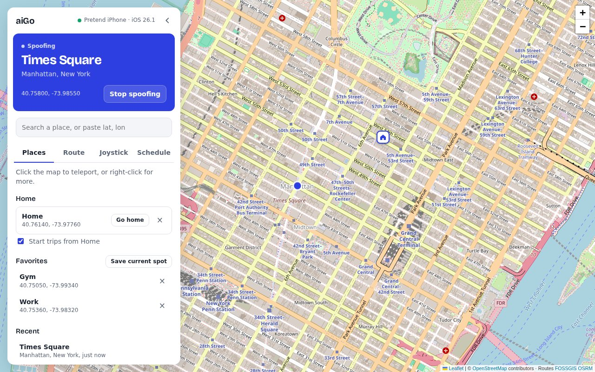
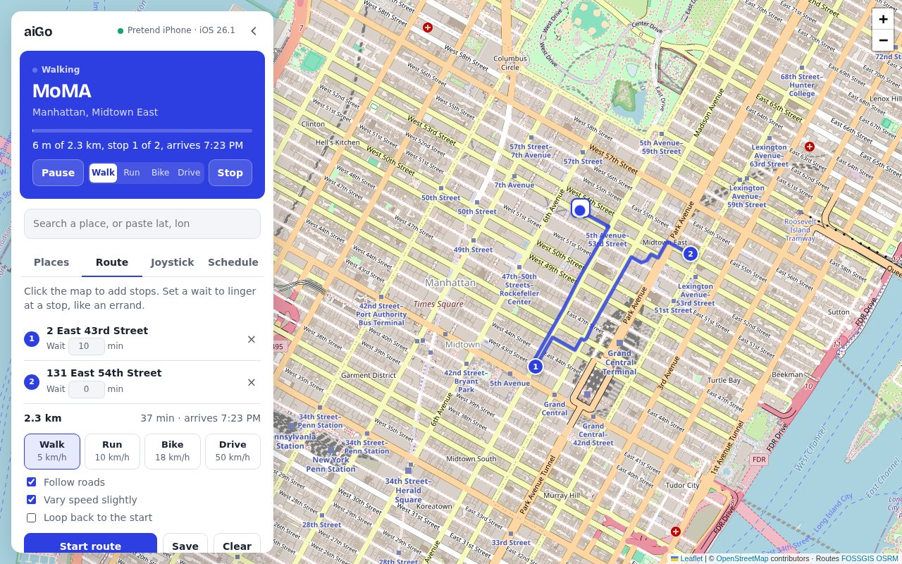
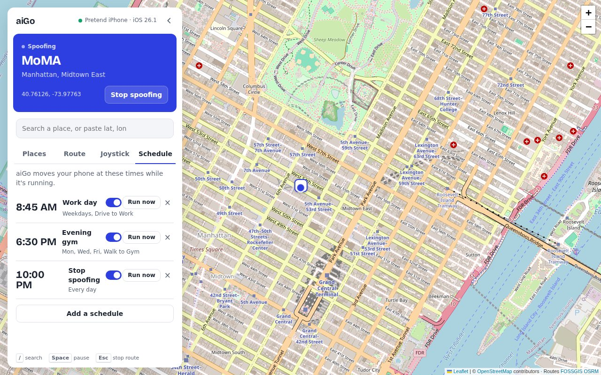
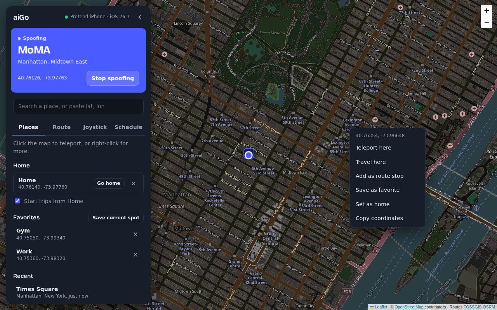
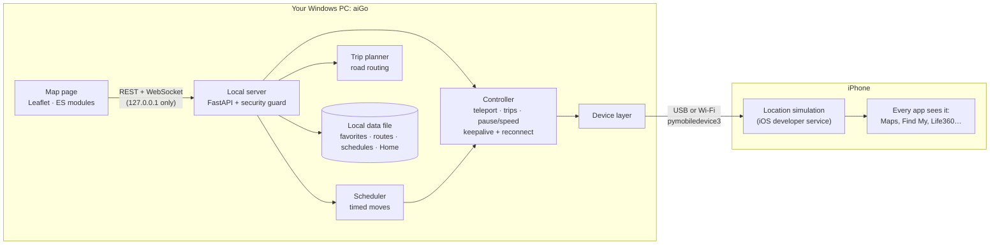

# aiGo

**A desktop location simulator for iPhone.** Pick a place on a map and the phone reports it to every
app: teleport instantly, walk or drive there along real roads, run errands with stops, or put moves on
a schedule. It runs on Windows, talks to the phone over USB or Wi-Fi, and needs no jailbreak, no app
on the phone and no admin rights.

I built it to replace a paid location-spoofing subscription with something I understand end to end.
It's useful for testing location-based apps and for controlling what location your phone shares.



## What it does

| | |
| --- | --- |
| **Teleport** | Click the map, search a place as you type, or paste `lat, lon`. The band at the top shows where the phone thinks it is, by name. |
| **Travel along roads** | Walk, run, bike or drive to a spot along real streets, at realistic speeds with slight pace variation. Pause, resume or change speed mid-trip. |
| **Routes with stops** | Click stops on the map and set a wait at each one ("stay 10 min at the store"). Save routes and replay them later. |
| **Schedules** | "Drive to Work at 8:45 on weekdays", "Stop spoofing at 10 PM". They run inside aiGo even with the page closed. |
| **Home** | Trips start from your house automatically, even when the phone is on its real GPS. |
| **Joystick** | Arrow keys or W A S D move the phone step by step. |
| **USB or Wi-Fi** | Uses the cable when plugged in, Wi-Fi otherwise. A watchdog re-sends the location every 5 s and reconnects after drops. |
| **Tray app** | A double-click `aiGo.exe` that lives in the system tray: Open, Stop spoofing, Quit. |



| Schedules | Dark mode and the right-click menu |
| --- | --- |
|  |  |

*Screenshots use aiGo's pretend-phone mode (`--fake`) with sample places in New York.*

## How it works

iOS has a location-simulation service for developers. It's the same one Xcode uses to fake GPS while
testing apps. Once the phone trusts the PC and Developer Mode is on, a computer can open a session
with that service and send it coordinates, and iOS reports those coordinates to every app. The
simulated location lasts only while the session stays open, so aiGo holds it open for as long as it
runs.



- **Device layer** (`aigo/device.py`) is the only code that talks to the phone. It opens the tunnel
  in-process (no admin), mounts the developer disk image, and holds the location session. If iOS
  changes, the fix goes in this one file.
- **Controller** (`aigo/controller.py`) owns the current position and the running trip. A trip is a
  set of legs between stops. It moves one step per second, so it can pause, change speed mid-leg and
  count down waits. A keepalive re-sends a held location every 5 s, which detects a dropped Wi-Fi link,
  reconnects, and restores the location.
- **Trip planner** (`aigo/routing.py`, `aigo/trips.py`) turns stops into a path along roads, picking
  foot, bike or car routing from the speed. It maps each stop's wait onto the path and falls back to
  straight lines if routing is unavailable. It runs server-side, so saved routes and schedules work
  without a browser.
- **Security guard** (`aigo/security.py`). The server listens only on `127.0.0.1`, but any website
  open in the browser can still try to reach it. The guard refuses foreign host names (DNS rebinding)
  and requests from other sites (cross-site requests and WebSocket hijacking). Without it, any open
  web page could read your Home address, track the phone live, or quietly stop spoofing.

## What I built vs. what I used

| I built | I used |
| --- | --- |
| Trip engine: legs, waits, pause/resume, live speed, pace variation, keepalive and reconnect | [pymobiledevice3](https://github.com/doronz88/pymobiledevice3) for the low-level iPhone protocol (tunnel, disk image, developer services) |
| Trip planning on top of a router, with stop-to-path mapping and fallbacks | [OSRM via FOSSGIS](https://routing.openstreetmap.de/) for road geometry |
| Scheduler, saved routes, Home, favorites and history | [FastAPI](https://fastapi.tiangolo.com/) / uvicorn for the HTTP server |
| The whole interface: status band, live trip controls, search, right-click menu, shortcuts, dark mode, mobile layout | [Leaflet](https://leafletjs.com/) and [OpenStreetMap](https://www.openstreetmap.org/) for the map |
| Security guard and its attack tests | [Nominatim](https://nominatim.openstreetmap.org/) and [Photon](https://photon.komoot.io/) for place names and search |
| Windows packaging: tray app, self-check, pinned build | [PyInstaller](https://pyinstaller.org/) and [pystray](https://github.com/moses-palmer/pystray) |

In numbers: about 1,500 lines of Python, 1,150 of JavaScript and 400 of HTML/CSS, plus 88 automated
tests.

I chose not to reverse-engineer the commercial app this replaces. The developer service it relies on
is publicly documented by open-source projects, so building on that kept aiGo legal to write and
easier to maintain.

## Getting started

**You need:** Windows with Python 3.12, the **Apple Devices** app (for the USB driver), and an iPhone
on iOS 17.4 or later.

1. **Prepare the phone.** Plug it in, unlock it, and tap **Trust**. Then turn on Developer Mode:
   ```
   py -3.12 -m pip install -e .
   py -3.12 -m pymobiledevice3 amfi reveal-developer-mode
   ```
   On the phone, go to Settings > Privacy & Security > Developer Mode, turn it on, and restart.
2. **Run aiGo.** Either double-click `build_exe.bat` once and then use `dist\aiGo\aiGo.exe` (a tray
   app), or run it from source:
   ```
   py -3.12 -m aigo
   ```
   The map opens at http://127.0.0.1:8765. The first connection downloads Apple's signed disk image,
   so it needs internet.
3. **Try it without a phone:** `py -3.12 -m aigo --fake`

To quit, use **Quit aiGo** in the tray menu, or press Ctrl+C when running from source. Either way,
the phone returns to its real location.

### Options

| Option | What it does |
| --- | --- |
| `--fake` | Pretend phone, no iPhone needed |
| `--tray` / `--console` | Tray icon or console window (the exe defaults to tray, source to console) |
| `--self-check` | Check that every phone component loads, then exit (handy for a packaged build) |
| `--udid UDID` | Choose a phone when several are connected |
| `--rsd HOST PORT` | Fallback: use a tunnel from `pymobiledevice3 lockdown start-tunnel` (admin) |
| `--port N`, `--no-browser`, `--no-mount`, `-v` | Port, don't open the browser, skip the disk image, debug logs |

### Wi-Fi (no cable)

1. Mark your home Wi-Fi as **Private** in Windows (Settings > Network & internet > Wi-Fi). On Public
   networks Windows blocks the discovery the phone relies on.
2. In **Apple Devices**, with the phone plugged in, turn on **Show this iPhone when on Wi-Fi**.
3. Unplug. The status pill should read "· Wi-Fi".

If the phone sleeps, the location can briefly revert. aiGo reconnects and puts it back, but use the
cable when the location has to hold reliably.

### Keyboard

`/` focuses search · `Space` pauses or resumes a trip · `Esc` stops a trip · arrows or W A S D drive
the joystick.

## Privacy

- **Stays on your PC:** favorites, routes, schedules and Home, all in `%APPDATA%\aiGo\data.json`.
  The local server is reachable only from this computer and only by aiGo's own page.
- **Sent to outside services:** what you type in search (Photon), points shown on the band and in
  lists (Nominatim, cached locally), and trip points, including Home when a trip starts there
  (OSRM). Map tiles come from OpenStreetMap. Nothing else leaves the PC.
- **Responsible use.** People who share location with you, like family on Life360, may rely on it
  for safety. aiGo makes it easy to see when you're spoofing (the band turns blue) and to stop.

## Testing

```
py -3.12 -m pip install -e ".[dev]"
py -3.12 -m pytest
```

- **88 automated tests** cover geometry, trip planning (with a stubbed router), the trip engine
  (waits, pause, speed changes, reconnects, keepalive), the scheduler (days, time windows, failures),
  every API endpoint, and the security guard. The guard tests replay the attacks found in a security
  review and check that each one is refused.
- **The interface** was tested end to end in a headless browser against the pretend phone: search,
  teleport, routes with waits, save and replay, pause and speed, schedules, Home, dark mode and the
  mobile layout.
- **On the real phone** (iPhone 14 Pro, iOS 26.1): connecting over USB and Wi-Fi, teleporting, walking
  along roads, and a location holding through a phone lock.

## Building the exe

Double-click `build_exe.bat`. It creates an isolated build environment, installs the exact package
versions in `packaging/build-constraints.txt` (the ones verified on the phone), and produces
`dist\aiGo\aiGo.exe`. It refuses to run while aiGo is open, because rebuilding then would half-delete
the app folder. Keep the exe inside its `aiGo` folder.

To move to newer versions deliberately, for example when an iOS update needs a newer pymobiledevice3,
edit that line in the constraints file, rebuild, and test on the phone.

## Troubleshooting

| Problem | Fix |
| --- | --- |
| Phone missing, or shows only as `Network` in `py -3.12 -m pymobiledevice3 usbmux list` | Unplug, unlock, replug. Still missing: end **AppleMobileDeviceProcess.exe** in Task Manager (Details tab), then open the Apple Devices app. |
| Phone not found over Wi-Fi | Check the network is Private, run `Restart-Service "Bonjour Service"` in an admin PowerShell, then restart AppleMobileDeviceProcess as above. |
| "Apple's device service isn't running" | Open the Apple Devices app. |
| "Developer Mode is off" | Run `py -3.12 -m pymobiledevice3 amfi reveal-developer-mode`, then turn it on in Settings > Privacy & Security. |
| The exe shows an error | Details are in `%APPDATA%\aiGo\aigo.log`. `aiGo.exe --self-check` shows whether a component is missing. |
| `No module named pymobiledevice3` | You ran a different Python; use `py -3.12`. |

## Limitations

- Windows only, one phone at a time, and iOS 17.4 or later (older versions need the admin `--rsd`
  tunnel).
- iOS accepts only a position, not a speed or heading. Realism comes from how positions are spaced
  over time.
- Schedules run only while aiGo is open. A time missed while it was closed isn't run later.
- An iOS update can break the connection until pymobiledevice3 supports it.

## Project layout

```
aigo/
  device.py      the only code that talks to the iPhone
  controller.py  position, trips (legs, waits, pause, speed), keepalive, reconnect
  routing.py     road routing and trip planning
  trips.py       starting trips, saved routes, scheduler, Home origin
  server.py      local API and WebSocket
  security.py    host/origin guard for the local server
  store.py       favorites, history, routes, schedules, settings (JSON)
  tray.py        system tray mode
  static/        the page: index.html, style.css, js/ modules, bundled font
packaging/       PyInstaller recipe, launcher, icon, pinned build versions
tests/           88 tests
docs/screenshots/
```

## Credits and licenses

aiGo is free software under the **GNU General Public License v3.0 or later** (see [LICENSE](LICENSE)),
matching pymobiledevice3, which it's built on. You can use, study, change and share it; if you
distribute aiGo or a build of it, you must share the source under the same license. Map data ©
OpenStreetMap contributors (ODbL). Routing by FOSSGIS OSRM. Search by Photon (komoot). Font:
Bricolage Grotesque, SIL Open Font License (`aigo/static/fonts/OFL.txt`).
